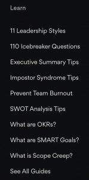

Most SEOs would agree that adding more internal links is a fairly efficient way to improve rankings for a blog, an asset or a commercial page. They'd probably also agree that manually updating links is boring and time-consuming.

Updating your menu or footer link can help solve this issue by adding a hefty number of internal links to specific pages. As they're usually site-wide, they're guaranteed to pass a lot of value and decrease crawl depth. On top of it, updating one link takes just a few seconds. So lots of wins with very few calories spent!

If this is something you'd like to try, this article will show you how to build a business case to convince your company or client to redesign the menu and footer links. I'm sharing my personal pitching process that helped me "translate" the benefits of the change to stakeholders, implement changes and improve SEO results.

## Why revamp the menu and footer in the first place?

I've had the opportunity to implement new menus and footers a few times and achieve strong results. In one, around one month in we could see some promising improvements in terms of leads. After 6 months all the newly boosted pages brought 68% more trials than the previous period.

In this case, there were 16 new links on the menu or footer (just swapping, no extra slots) and 10 of them had significant increases, up to 400 new leads – or 380% in 6 months!

Benefits of revamping menu and footer links:

- Better user experience and product value exposure
- More traffic and leads to relevant pages
- Easy to implement and maintain with ongoing updates

## Roadblocks and risks

Usually there's no "bureaucracy" to add an internal link on a blog post, as you can add several on a page. No CEO will fight over a blue link in a paragraph, especially if you're guiding readers to another piece of content you own. Chances are most people won't even notice it.

That's very different for a menu or footer. Although we want to make changes for SEO, from a business perspective, the priority should be to showcase your product offer – a product tour, pricing, FAQs, main product categories, etc. Menus are made to guide people, and using them for internal links to relevant pages should be a natural choice, but there's still some space to combine business and SEO needs.

There's the obvious risk of creating noise and moving users away from the main goal you want them to do. If you're an e-commerce, your main categories should be there. If you offer a product or service, pricing, login, sign up, contact and action (e.g. "book now", "try now", etc) are your essential menu items.

We naturally get so distracted while browsing, and the last thing you want is to create noise and lose conversions. Finding the sweet spot between navigation and money pages is key.

## The business case

In such an important element of a website, you can expect a lot of eyes and pushback to make a change like this "for SEO reasons", so I recommend not going the SEO route, but the user experience route.

How often are these menu and footer links clicked? You can create a Custom View on GA to discover that or simply just see, overall, how many users view these pages. I've seen menu links that had fewer than 50 clicks per month – which, in fact, made these pages almost irrelevant in general, let alone taking a prime menu spot.

If you compare the most vs least clicked menu items, there's a pretty strong argument to get rid of pages that have no clicks. And since users might ignore them, you can propose to use the same real estate to add a link that has more potential to get clicks, and ultimately help the company – sales, trials, leads, whichever is your goal.

This way, you're not requesting to add new items, simply just swap a slot, which will make the change easier in terms of convincing stakeholders and from a development perspective.

Here's where you can get creative.

While it would be odd to link directly to a blog post or another non-essential resource from the menu, there are ways around it. You can arrange these links into wider buckets.

Let's say you want to promote some pillar content. You could call them "Resources", "Guides", "Learn" or even "Latest News" to cast a wider net, and have a few items as a sub-menu. Do you want to boost links for specific products, as opposed to a category? Name it "Best Sellers", "Deals", "Gift Ideas", "Sale" or "Trending". Some of these will be created organically but you could still spot high-margin products or get ahead of the season by placing a link before you expect it to become a hit.

| Content type | Menu name ideas |
|---|---|
| Blog, Guides, Videos, Webinars, E-books | Resources, Learn, Latest News |
| Catch-all products | Best Sellers, Deals, Gift Ideas, Sale, Trending |
| Product Features, Templates | Solutions, Product, Tour, How to Use |
| Support, Events, App, Product, Pricing, Sitemap | About |
| Reviews, Comparison, Alternative | Compare |

## Choosing what to include

What fits on your menu, really? The answer, eh, it depends – but I'll tell you on what it depends and you can make the appropriate choice. Do you want to boost URLs that are already on page one but not bringing traffic yet, or do you rather go bigger and focus on the pages with the most potential in the long term?

In the opportunities I had to implement new menus and footers, I've mixed both: some pages that are close to reaching top rankings with the highest potential ones, so you can bring results as quickly as possible while buying time to work on the bigger prize with other SEO strategies and tactics. Traffic usually is secondary, so make sure to look at conversions (from all channels) and conversion rates before you make this decision. Visual analytics software also comes in handy here (perhaps on your homepage only) so you can see how people interact with your menus and sub-menus.

To help convince stakeholders who are not into SEO to get on board, you can analyse your competitors' menus to show their strategy and if it's being effective. Take this with a pinch of salt, but you could correlate internal links with their non-branded organic traffic (use Semrush, Ahrefs or your favourite keyword tool to look for it).

This is certainly a style, but I'm always in favour of building a nice deck (might be the result of years working in agencies!).

Also, make it visual. This is a big change, things might get lost in translation, and words alone are unlikely to convince stakeholders (we care about internal links, non-SEO stakeholders not as much).

You can also:

- Prepare slides showing competitors' menu items and non-branded traffic
- Use Chrome Dev Tools to make the changes on your browser

## Conclusion

Revamping the menu and footer links can be one of those low-hanging fruits clients are always asking for. The steps I described above worked for me a few times for existing websites and can also be implemented during a website redesign, a completely new website or even if you want to have certain flexible slots. Hopefully, this short guide will help you to overhaul your menu and footer and improve your KPIs!
