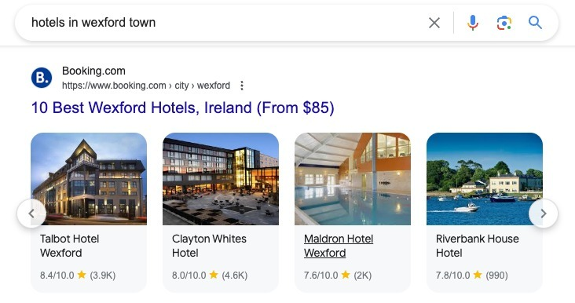

The Digital Markets Act is a new EU (European Union) law coming into effect on March 6th. It defines some large digital platforms, such as Google, as "gatekeepers" and puts measures in place to control how much power these companies have, preventing them from having way too much control over the market.

A company is a gatekeeper if it:

- Has a strong economic position, significant impact on the internal market and is active in multiple EU countries
- Has a strong intermediation position, meaning that it links a large user base to a large number of businesses
- Has (or is about to have) an entrenched and durable position in the market, meaning that it is stable over time if the company met the two criteria above in each of the last three financial years

As defined in September 2023, the current [DMA gatekeepers](https://digital-markets-act.ec.europa.eu/gatekeepers_en) are Alphabet (Google's parent company), Amazon, Apple, Bytedance (TikTok), Meta and Microsoft.

There are several do's and don'ts these companies must follow to adhere to this law. You can read them all on the [European Commission website](https://commission.europa.eu/strategy-and-policy/priorities-2019-2024/europe-fit-digital-age/digital-markets-act-ensuring-fair-and-open-digital-markets_en). This post focuses on Google Search only, and here are two of the most relevant points that will help you understand the changes coming in the SERPs:

- **Do:** allow third parties to inter-operate with the gatekeeper's own services in certain specific situations
- **Don't:** treat services and products offered by the gatekeeper itself more favourably in ranking than similar services or products offered by third parties on the gatekeeper's platform

## How does it affect Google?

For Google, the following products are considered gatekeepers: Google Search, Google Maps, Google Play, Google Shopping, Google Ads, Chrome, Android, YouTube.

To adapt to this law, Google is changing how the SERPs look in several verticals: Travel, Local, Shopping and Jobs. Below, I discuss which changes have already been implemented and that I managed to trigger searching from Ireland. Some of these changes can really affect (positively) SEO opportunities in these areas.

While Google is implementing changes, it also shared some criticism of the law in a [blog post](https://blog.google/around-the-globe/google-europe/an-update-on-our-preparations-for-the-dma/) back in January:

> While we support many of the DMA's ambitions around consumer choice and interoperability, the new rules involve difficult trade-offs, and we're concerned that some of these rules will reduce the choices available to people and businesses in Europe.

I expect more changes to happen until and after the law takes effect, starting March 6th 2024. The findings below are just those I managed to trigger. For instance, the Jobs SERP vertical should be affected but I haven't seen changes in Ireland yet.

Update: I've been invited by the [Search with Candour podcast](https://withcandour.co.uk/blog/what-is-the-digital-markets-act) to talk about the DMA.

## New refinement chip (query filter) – "Places Sites"

Back in January, Google started displaying this query filter between other query refinement filters, which they call refinement chips. I used to call these filters, but to keep things simple, I'll call them their official name, refinement chip.

This refinement chip removes every SERP feature from the results: no Google Maps, no People Also Ask, Images or Related Searches.

It also only leaves aggregators in the search results (more about them below). If you're looking for a restaurant or a hotel, this means excluding even the actual website from the restaurant or hotel, leaving websites like Booking and Expedia (for hotels), Trip Advisor and Open Table (for restaurants), Yelp and Foursquare (for local businesses).

## "Places Sites" SERP feature

Beyond the refinement chip above, there's also a SERP feature called "Places Sites" (yes, two features, same name) that displays aggregators. This is a standard feature (no extra action is required to trigger it), usually displayed just after the local pack.

Update: [Near Media did an interesting study](https://www.nearmedia.co/google-serp-restaurants-eu-dma-analysis/) testing the impact of this SERP feature with 100 real users in Ireland. Spoiler alert: it's not used.

## What is considered an aggregator

Things get quite interesting here. Google seems to have a broad definition of what an aggregator is: beyond well-known brands, I've seen small blogs, government tourism websites and even my local council website in this feature.

It's defined on a page level: does this page act as an aggregator? E.g. listing and evaluating the best restaurants in a location? If so, you may be eligible for this SERP feature. This is a positive way to make the SERPs more diverse – I found a few blogs in the first positions.

There are also some odd results. Looking for mechanics near me in Ireland, the first results were relevant but quickly went as far as Bournemouth (UK), Australia and New Zealand (!). The definition of aggregator is so broad that even [Facebook pages](https://www.facebook.com/biz/automotive-repair/?place_id=109095619110754) are eligible. Some Facebook pages are actual listings but others are just official pages from actual businesses, which fails to meet the definition of aggregator – maybe Facebook as a whole was defined as an aggregator?

Now that you're familiar with some of the new features, let's dive into how it's affecting specific industries.

## Changes in Hotel SERPs

Hotel SERPs now have two features using the "Places Sites" name and a third brand-new horizontal design.

- "Places Sites" chip refinement
- Horizontal "Places Sites" SERP feature carousel displaying ten aggregators
- Horizontal carousel displaying several hotels inside one page

The "Places Sites" SERP feature, a carousel with several OTAs (Online Travel Agency), appears just below the local pack. Ps: hotels always had four map results instead of three.

Another new feature is the horizontal carousel for each OTA, displaying hotel images, ratings, number of reviews and price. Clicking on these images will send you to the respective hotel page, on the OTA website.

If the "Places Sites" refinement chip is selected, then the Hotels Local Pack and hotels' websites are removed from the SERPs. While this diminishes Google's own travel product visibility, it doesn't give any to actual hotels. Large online travel agencies are the winners here.

## Changes in local SERPs

These new features also affect the SERPs for a broad range of local businesses and services. For instance, searches including a [location] or [near me] for restaurants, doctors, carpet cleaning, things to do, furniture shops and others all have both the "Places Sites" refinement chip and "Places Sites" SERP feature.

As usual, if you select the "Places Sites" refinement chip, all local businesses disappear, leaving only aggregators – or in this case, packed with directories that don't necessarily provide the best results. I doubt people will use either feature much, given the quality of results vs what Google provides on Google Maps or businesses already listed on page one.

Would anyone want to go from one list of providers on SERPs or Maps, with images and tons of reviews, to another more antiquated list, with fewer images, poorer UX and no reviews?

There are some relevant websites, such as popular marketplaces that are actually relevant and used by people (e.g. DoneDeal, listing used products for sale), but I also easily found several results from websites that I couldn't even say are still being managed. Looking for an electronic store, I ended up on a page about the history of a famous Dublin street.

I understand the idea of giving options beyond Google Maps to comply with the law, but the results are far from reaching the search intent of users at this stage.

## Changes in Flight SERPs

One of the Digital Markets Act rules is that Google can't treat its own services and products more favourably, so the Google Flights SERP box is gone. This is perhaps where Google loses most of its SERP advantage of all the examples shown in this post.

Google Flights, although very handy (and my go-to flight search engine), does take a lot of SERP space and gives Google a huge advantage vs travel agencies and airlines. Note: [Google used to get a commission from airlines and OTAs](https://skift.com/2020/01/22/google-flights-ends-booking-charges-for-airlines-that-paid/) until 2020, now all links on Google Flights are free listings. There are several other substantial changes in flight-related SERPs:

- Airline options (SERP feature)
- "Flights Sites" SERP feature
- "Flight Sites" chip refinement
- Rich Web Results displaying "from" price
- "Airline Sites" chip refinement

When you search for "flights to [destination]", Google now first shows airline options, pulling prices directly from the airlines with a suggested flight date. For some reason, these are not direct links, but a redirect from google.com/flights to the airline website instead (it might just be a technicality).

Then a "Flight Sites" feature, similar to "Places Sites", with a horizontal carousel displaying ten price aggregators, always well-known OTAs (Booking, Expedia, Kayak, etc).

A "Flight Sites" (yes, same name used twice again) chip refinement removes all SERP features, keeping only aggregators (in this case, only OTAs) in the results. I noticed both "Flight Sites" and "Places Sites" refinements, but they show the same results.

Another SERP feature available only for flight-related SERPs is the new Rich Web Results showing flight information: date, number of stops, one-way/return and price. This takes a similar space to what was previously used to show FAQs.

While the Google Flights box is gone, I found it quite interesting to spot that Google itself became an aggregator competing the same as an OTA. I can't recall if Google Flights pages were indexable in the past, but now you can find them in the traditional SERP results and the "Flights Sites" snippet.

There's even an "Airline Options" refinement chip that shows only airlines. It removes everything else from the SERPs and displays only airline websites.

## Conclusions and predictions

Chip refinements like "Places Sites" remind me of simpler times with a simpler SERP – I don't expect a large percentage of searchers to use it, because it's a discreet filter, similar to other search refinements. Searchers will barely notice it.

Personally, I wish these filters that aim to increase competitiveness wouldn't exclude the final businesses serving the consumer (the actual restaurant or hotel) from any SERP. It's still positive that Google's influence has decreased and there are more opportunities for diverse results.

Other SERP elements might be used a bit more, such as the Places Sites SERP feature. Some results are relevant and might give new life to marketplaces and directories, however, right now a large portion of them give a refinement worse than Google would. I expect Google to improve its definition of an aggregator because it's very confusing right now and quality can be very poor – I can find the Facebook page for a business, while their actual website is removed.

Marketplaces and blog posts with listicle content could benefit because they are currently classified as an aggregator, and I found relevant results displaying these pages – results I'd actually click and that fulfil the intent behind my search. It's more SERP real estate for SEOs to explore.

It's important to remember that the Digital Markets Act will only be enforced from March 6th. Google is likely gathering data to understand impact and quality, and the European Union might still require gatekeepers to make changes to abide by the new law, so results might change until next month and beyond.
