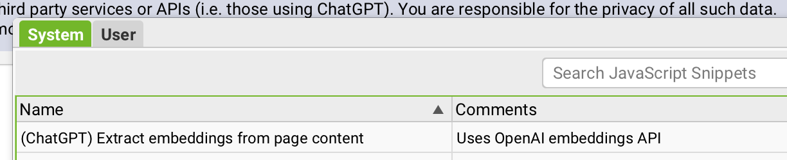
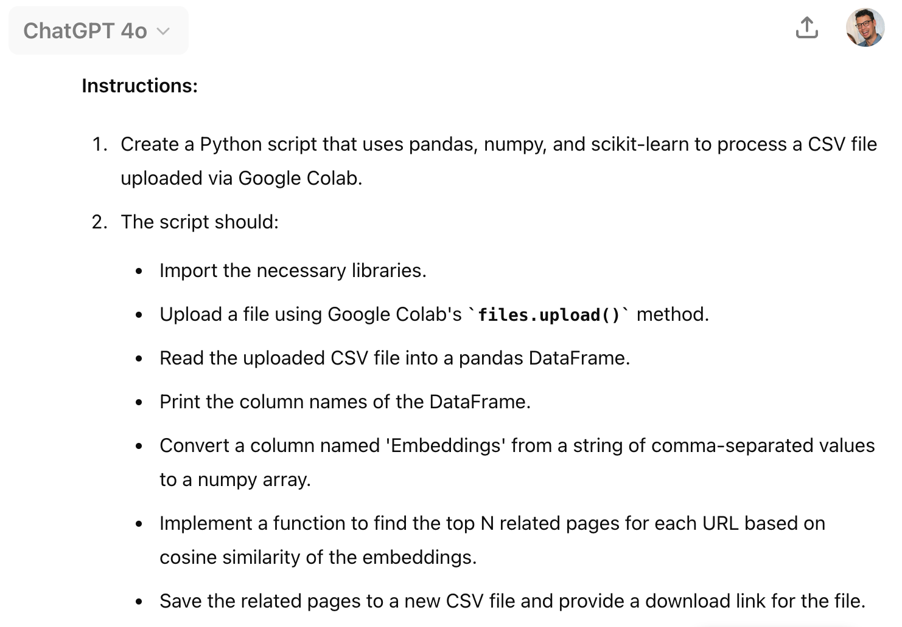
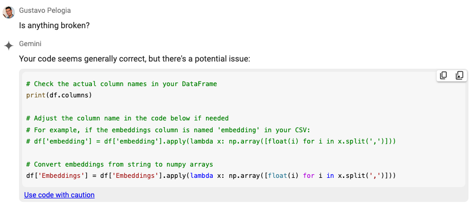

Would you like to map thousands of related pages in seconds? In this article, I'll show you how. You don't need to know how to code – LLMs are writing the Python code for you. All you need is some creativity and a bit of patience in trial and error until the code is right.

You can use this to find related products, add internal links, find articles on the same topic, tag pages, etc. Any kind of analysis/output that reads the content and lists URLs can be done fairly quickly – in a few minutes.

I'll go step by step on how to do this, but I promise the article won't be too long.

## What are embeddings?

When Screaming Frog released v20 and allowed you to connect to OpenAI, they also included a prompt template that allows you to extract embeddings from a page. I had no idea what that meant and ignored it completely until I read Mike King's article titled [SEO Use Cases for Vectorizing the Web with Screaming Frog](https://ipullrank.com/vector-embeddings-is-all-you-need).

His article is fairly technical and deep, it took me a few reads to understand what was going on until I realized that a goldmine was sitting in front of me.

In short, vector embedding is a technique in Natural Language Processing (NLP) that captures the meaning and relationship between words. Screaming Frog will give you an export of URLs and a bunch of very long numbers – vector embeddings.

According to [Google](https://developers.google.com/machine-learning/crash-course/embeddings/video-lecture):

> Embeddings make it easier to do machine learning on large inputs like sparse vectors representing words. Ideally, an embedding captures some of the semantics of the input by placing semantically similar inputs close together in the embedding space. An embedding can be learned and reused across models.

All of the words are turned into numbers and compared to each other, to see what's the universe surrounding them. So we're not matching a few keywords, but rather the whole content proximity between one page and another. I'm sure there are better and more accurate explanations, this is just how I simplified it to myself to understand how to go ahead with it.

## What is cosine similarity?

Reading Mike's article I also learned about cosine similarity. It's a way to compare each vector group (all vectors in a URL) to another vector group, thus finding which ones are the most related to each other. Borrowing a definition from the same article:

> We can vectorize a list of pages and compare them against the target page using cosine similarity to determine its relevancy.

I've paraphrased a bit because his example was about link building, but the idea is the same: match pages that are similar to each other, covering the same general topic.

## Using Screaming Frog + OpenAI to extract embeddings

I consider myself a bit technical (and mostly work as a technical SEO these days) and despite many attempts, all "code" I can write is HTML and CSS. I find my way around a lot of technical SEO tasks, I know how to read a lot of technical things but can't code per se.

But I know enough to create this Python tool:

I've used Screaming Frog and the OpenAI API ($5 in credits will take you far) to get the embeddings for thousands of pages. Custom JavaScript > Add From Library > Extract Embeddings. All you need to do on Screaming Frog is find the prompt in the library and place your API key. Remember to also run your crawl with JavaScript rendering.

After the crawl was complete, I got a spreadsheet with a list of URLs + embeddings (a bunch of very long numbers). Export the CSV.

## Using LLMs to create a Python script

I then went to ChatGPT and asked it to give me a Python code that would allow me to map [X] related pages once I provided a spreadsheet with URLs + embeddings. My prompt also asked to import the aforementioned cosine similarity module.

It's been a few weeks and unfortunately, I tend to use ChatGPT without history saved (to prevent my prompts from being used for training) so I don't actually have the exact prompt, but I managed to paste the code (which I saved) and reverse-generate a prompt.

One thing I learned about Python after watching some of [Jean-Christoph Chouinard's Python tutorials](https://www.jcchouinard.com/python-for-seo/) is that you can use Google Colab, which is basically Python on your browser, without having to install anything. The code is run on a virtual machine on Google servers and a lot of things come pre-installed.

The code didn't work straight away, so I had to bounce back between ChatGPT and Gemini. The latter is available directly on Google Colab and can read your code and suggest fixes. After a few tries, the LLMs fixed my code.

All the code came straight from the LLMs. I saw the final output and it works for my needs, so I'm happy with the results.

## Conclusions and script

At this point, you're hoping to find a script – [HERE IT IS](https://colab.research.google.com/drive/16YuDGr3V0j_YahMZ0QXa4ckJ-uUHBrWf?usp=sharing)!

The tool will ask you to upload your CSV file (the one from Screaming Frog). The sheet should have two headers:

- URL
- Embeddings

Once it processes the data, it'll automatically download another CSV with the results in two columns:

- Page Source
- Related Pages

The results were good enough for my needs. Of course, you still need to review the output and make changes to avoid massive failures, but this is a strong working draft – and I solved weeks of manual work in a day!
